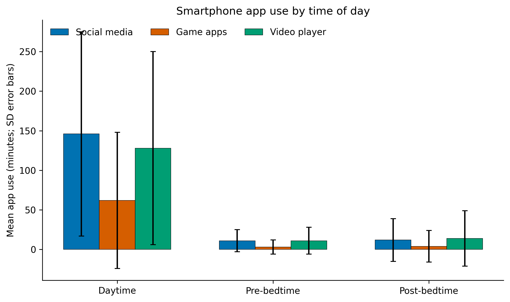
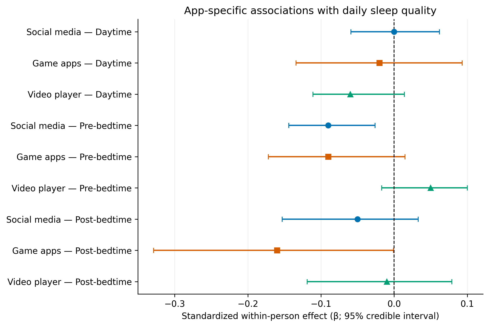
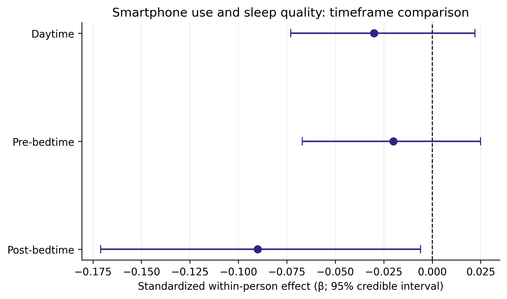

# Task 3 — Published statistical analysis of smartphone use and sleep quality

**Research topic:** The Association Between Late-Night Mobile Gaming and Social Media Activity on Smartphones and the Physiological Characteristics of Sleep Among Students.

This repository replaces the unrelated linear-search/hash-index benchmark with an analysis grounded in published sleep research.

## Important scope and data integrity note

The primary source is Siebers et al. (2024): 155 adolescents were monitored for 21 days; the study collected 1,950 daily sleep-quality assessments and 745,706 foreground app activities. The CSV files in `data/raw/` contain **aggregate statistics transcribed from Tables 1–4 of the paper**, not raw participant-level records. The project therefore visualizes and organizes the reported values; it does not claim to have independently re-run the authors' Bayesian DSEM models.

The source study measured sleep quality using a single daily 1–7 Pittsburgh Sleep Diary item. It did **not** report the Task 2 variables SOL, TST, WASO, REM/Deep NREM, or full PSQI in the tables used here. Those variables are not fabricated or derived from the 1–7 score.

## Repository structure

```text
research-repo/
├── config.yaml
├── data/
│   ├── raw/
│   │   ├── published_app_usage.csv
│   │   ├── published_phone_effects.csv
│   │   ├── published_app_effects.csv
│   │   ├── published_descriptives.csv
│   │   └── source_metadata.json
│   └── processed/                 # generated summary copies
├── docs/domain_model.md
├── notebooks/01_data_analysis.ipynb
├── reports/figures/               # PNG (300 DPI) and PDF
├── src/
│   ├── process_data.py
│   └── visualize.py
└── requirements.txt
```

## Reproduce

```bash
python -m venv .venv
# Windows: .venv\Scripts\activate
# macOS/Linux: source .venv/bin/activate
pip install -r requirements.txt
python -m src.process_data
python -m src.visualize
jupyter notebook notebooks/01_data_analysis.ipynb
```

## Published findings

### Descriptive statistics

| Measure | Mean | SD | Unit |
|---|---:|---:|---|
| Daily smartphone use | 6 h 8 min | 2 h 58 min | hours/day |
| Daytime smartphone use | 5 h 26 min | 2 h 37 min | minutes/day |
| Pre-bedtime smartphone use | 23 | 19 | minutes/night |
| Post-bedtime smartphone use | 29 | 49 | minutes/night |
| Daily sleep quality | 5.53 | 1.31 | 1–7 scale |

### App category use

| App category | Daytime M (SD), min | Pre-bedtime M (SD), min | Post-bedtime M (SD), min |
|---|---:|---:|---:|
| Social media | 146 (129) | 11 (14) | 12 (27) |
| Game apps | 62 (86) | 3 (9) | 4 (20) |
| Video player | 128 (122) | 11 (17) | 14 (35) |

### Main associations with sleep quality

| Predictor | Standardized within-person β | Bayesian p | 95% credible interval |
|---|---:|---:|---:|
| Daytime smartphone use | −0.03 | .122 | [−0.073, 0.022] |
| Pre-bedtime smartphone use | −0.02 | .162 | [−0.067, 0.025] |
| Post-bedtime smartphone use | −0.09 | .017 | [−0.171, −0.006] |
| Social media before bedtime | −0.09 | .001 | [−0.144, −0.026] |
| Game apps after bedtime | −0.16 | .024 | [−0.329, −0.001] |

The paper reports no statistically significant within-person association for daytime or pre-bedtime overall smartphone use. It reports a negative association for post-bedtime use. In exploratory app-specific analyses, social media use in the hour before bedtime and game use after bedtime were negatively associated with sleep quality.

**Interpretation:** The findings are associations in an adolescent sample. They do not prove that smartphone activity caused poorer sleep. The study also does not establish effects on SOL, TST, WASO, REM or Deep NREM.

## Figures

### Figure 1 — App use by timeframe



### Figure 2 — App-specific associations



### Figure 3 — Overall smartphone use and sleep quality



All plots show reported aggregate means or model estimates. Error bars in Figures 2–3 are the 95% credible intervals published in the paper, not bootstrap confidence intervals.

## Supplementary source: MMASH

The MMASH dataset (Rossi et al., 2020; PhysioNet) contains 22 healthy young adult male participants and includes total sleep time, WASO, awakening counts, PSQI, activity, and stress data. It can support a **separate** physiological sleep analysis. It does not provide matching social-media/game app exposure data, so it must not be joined to the Siebers dataset as if the same participants were measured in both studies.

Dataset: https://physionet.org/content/mmash/1.0.0/

## Limitations and threats to validity

1. **Population mismatch:** Siebers et al. studied adolescents aged 13–16, while Task 2 is framed around students. Generalization to university students is limited.
2. **Outcome mismatch:** daily sleep quality was a 1–7 rating, not full PSQI or objective sleep staging.
3. **No physiological staging in primary source:** SOL, TST, WASO, REM and Deep NREM are not available in the published tables used here.
4. **Observational evidence:** associations do not establish causality.
5. **Aggregate data:** no participant-level reanalysis, bootstrap CI, or independent p-value calculation is possible from table summaries alone.

## References

- Siebers, T., Beyens, I., Baumgartner, S. E., & Valkenburg, P. M. (2024). *Adolescents’ Digital Nightlife: The Comparative Effects of Day- and Nighttime Smartphone Use on Sleep Quality*. Communication Research. https://doi.org/10.1177/00936502241276793
- Dataset: University of Amsterdam DARE, https://doi.org/10.21942/uva.26395903.v2
- Rossi, A., et al. (2020). *A Public Dataset of 24-h Multi-Levels Psycho-Physiological Responses in Young Healthy Adults*. Data, 5(4), 91. https://doi.org/10.3390/data5040091
- MMASH on PhysioNet: https://doi.org/10.13026/cerq-fc86

## Authors

This research project was developed by:

- **Alikhan Nurmetov**
- **Tanirbergen Bekzhan**