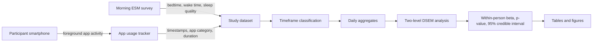

# Domain model — smartphone activity and sleep quality

## Research context

The primary evidence source is Siebers et al. (2024), a 21-day intensive longitudinal study of 155 adolescents. Foreground smartphone activity was tracked and sleep quality was reported each morning. The published dataset contains app-category and timeframe data (daytime, pre-bedtime, post-bedtime).

## Measurement points

- **MP1 — App tracking:** timestamp and duration of foreground app use.
- **MP2 — Timeframe:** daytime, hour before bedtime, and after bedtime.
- **MP3 — Category:** social media, game apps, video player apps.
- **MP4 — Sleep outcome:** one 7-point Pittsburgh Sleep Diary sleep-quality item each morning.
- **MP5 — Statistical output:** standardized within-person and between-person estimates from Bayesian DSEM.

## Variables and operationalization

| Variable | Role | Unit / scale | Source |
|---|---|---|---|
| Social media use | Predictor | minutes per timeframe | App tracking |
| Game app use | Predictor | minutes per timeframe | App tracking |
| Video player use | Comparison predictor | minutes per timeframe | App tracking |
| Sleep quality | Outcome | 1–7 daily rating | Morning ESM |
| Bedtime / wake-up time | Timeframe boundary | clock time | Morning ESM |

The Task 2 variables SOL, TST, WASO, REM/N3 and full PSQI are **not** reported in the primary study's outcome tables used here. They must not be inferred from the daily 1–7 sleep-quality item.

## Statistical model

The paper uses two-level Dynamic Structural Equation Modeling (DSEM), with daily observations nested within participants. This repository records published estimates and does not re-estimate DSEM from aggregate summary values.

\[
Y_{it}=\alpha_i+\beta_W(X_{it}-\bar X_i)+\phi Y_{i,t-1}+\epsilon_{it}
\]

where \(Y_{it}\) is sleep quality for participant \(i\) on day \(t\), \(X_{it}\) is app use, \(\beta_W\) is the within-person association, and \(\phi\) represents the lagged sleep-quality term.

## Threats to validity

| Threat | Why it matters | Mitigation / interpretation |
|---|---|---|
| Population | Participants were adolescents (mean age 14.5), not university students | Do not claim direct generalization to university students |
| Outcome measure | Daily 1–7 sleep diary item, not full PSQI | Keep scale label exact; do not relabel as PSQI |
| Observational design | Associations do not establish causality | Use “associated with”, not “caused” |
| Same-window measurement | Nighttime phone use and sleep are measured over overlapping periods | Reverse direction is possible |
| Device coverage | App tracking was available only for Android devices | Sample may differ from excluded non-Android users |
| Aggregate-only analysis here | CSVs in this repository are published table values, not participant rows | No bootstrap, raw-data p-values, or participant-level reanalysis |
| Separate MMASH source | MMASH has physiological sleep measures but no matching app-category exposure records | Keep MMASH as a separate supplementary source; do not merge participants |

## Supplementary physiological dataset

MMASH (Rossi et al., 2020; PhysioNet) includes 22 healthy young adult men and sleep variables such as total sleep time, WASO, awakenings, PSQI, activity, and stress. It is documented as a possible separate follow-up analysis, but its observations are not mixed with the Siebers sample.
